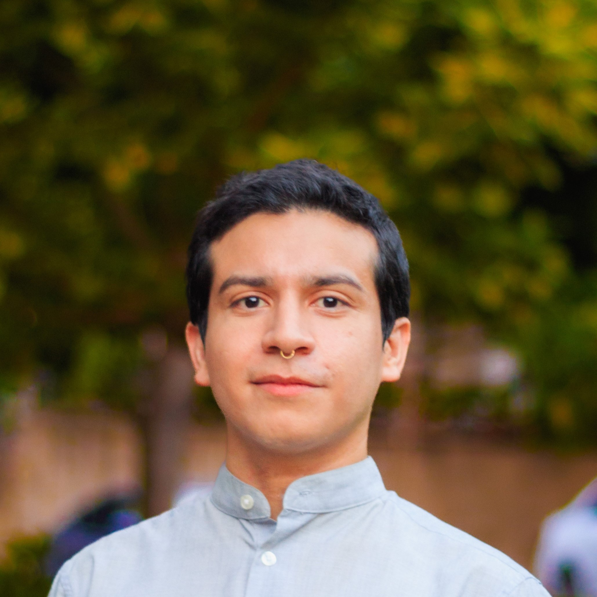

::: {.home-grid}

::: {.home-side}

```{=html}
<div class="home-name" role="heading" aria-level="1">Rony Rodrigo Maximiliano<br>Rodríguez-Ramírez</div>
<div class="home-affil">Harvard University</div>

```

::: {.home-contact}
**Email:** rrodriguezramirez \[at\] g \[dot\] harvard \[dot\] edu


:::

:::

::: {.home-main}

Hi! I'm a second year Ph.D. student in Education Policy and Program Evaluation (Economics of Education Field Course). My research is driven by a central question: **How can education systems be adapted to protect and rebuild human capital when faced with large-scale shocks like conflict, displacement, and political crises?** My academic and personal journey, which started in Nicaragua, has given me a strong motivation to address learning inequalities caused by political instability and forced migration.

I focus on designing and evaluating scalable interventions that can reduce these inequalities. A core part of my approach is to integrate robust psychosocial support within educational settings to ensure all children can learn effectively. The centerpiece of my current work is a large-scale randomized controlled trial (RCT) in Armenia that I co-lead across 450 public schools. This project is designed to meet the educational and psychosocial needs of children displaced by the Nagorno-Karabakh conflict. I also recently co-led another RCT in Ukraine with over 10,000 students, where we embedded mental health components into an online tutoring program and saw positive impacts on learning outcomes and student well-being.

I am affiliated with the [Center for International Development (CID)](https://www.hks.harvard.edu/centers/cid/about-cid/people/phd-affiliates/rony-rodrigo-maximiliano-rodriguez-ramirez), the [Institute for Quantitative Social Science (IQSS)](https://www.iq.harvard.edu/people/rony-rodrigo-maximiliano-rodriguez-ramirez), and the Education Policy Lab for Latin America. My ultimate goal is to produce rigorous research that can inform social policies and create effective pathways toward more just societies.



:::

:::
