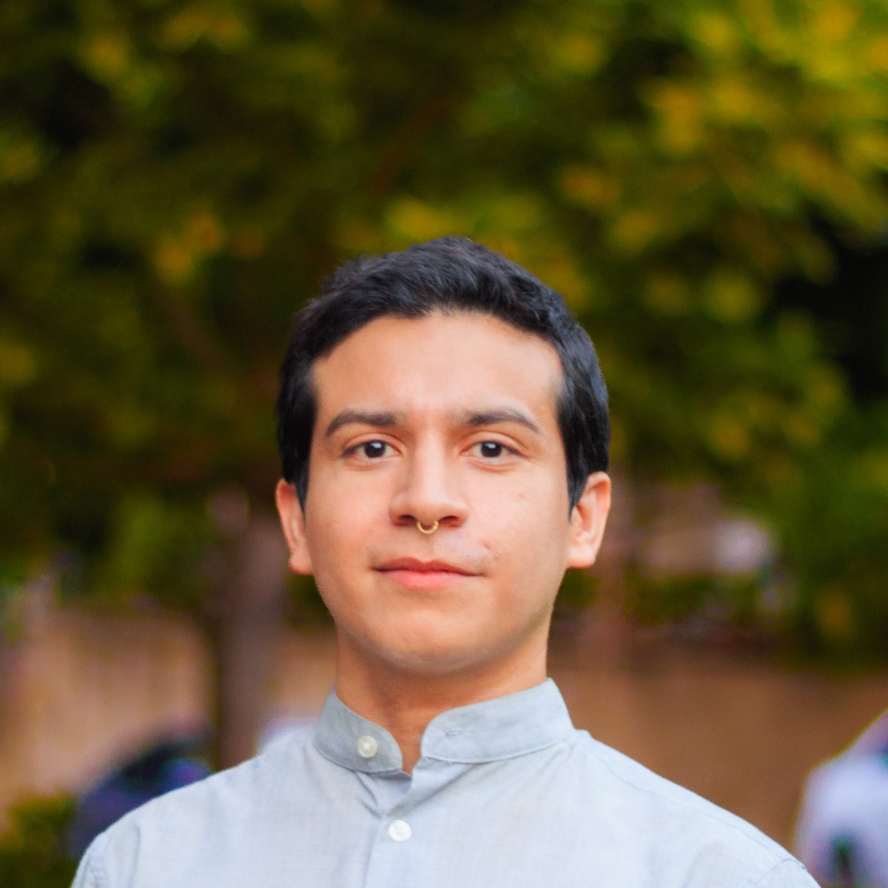
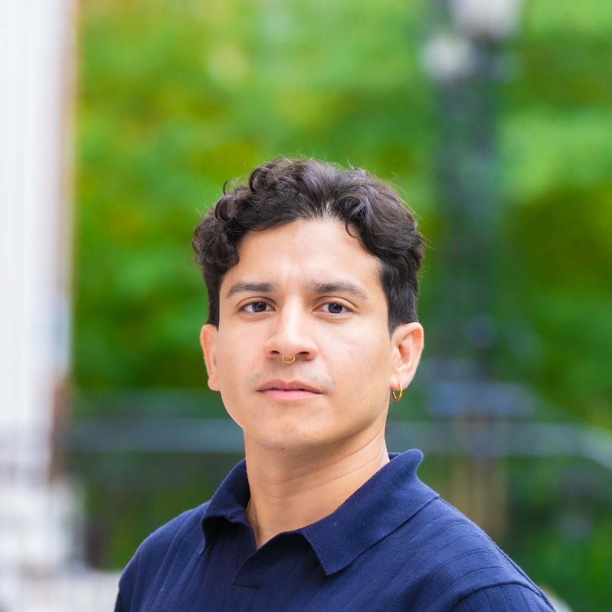

::: {.home-grid}

::: {.home-side}

```{=html}
<div class="home-name" role="heading" aria-level="1">Rony Rodrigo Maximiliano<br>Rodríguez-Ramírez</div>
<div class="home-affil">Harvard University</div>
<div class="home-photo-wrap">
<button type="button" class="home-photo-btn" aria-pressed="false" aria-label="Flip the photo">
  <span class="home-photo-flip">
    
    
  </span>
</button>
<div class="photo-note">
  <p>me now, in my 4th year!<span class="photo-note-tail" aria-hidden="true"><svg viewBox="0 0 40 52"><path d="M2 44 C 22 47, 37 37, 32 6 M 24 13 L 32 4 L 38 14"/></svg></span><small>the other one: starting the Ph.D.</small></p>
</div>
</div>
```

::: {.home-contact}
**Email:** rrodriguezramirez \[at\] g \[dot\] harvard \[dot\] edu


:::

:::

::: {.home-main}

Hi! I'm a fourth-year Ph.D. ~~student~~ candidate in Education Policy and Program Evaluation, and my field course is in the Economics of Education. I'm originally from Nicaragua, where I grew up and lived until I finished my bachelor's degree. As of today, my research is on how education can protect and rebuild children's human capital after armed conflict, forced displacement, and political crises.

I am currently co-leading a randomized controlled trial in 450 public schools in Armenia, which tests an education and psychosocial program for children displaced by the Nagorno-Karabakh conflict. I also recently co-led another RCT in Ukraine with more than 10,000 students, where we added mental health components to an online tutoring program.

I am affiliated with the [Center for International Development (CID)](https://www.hks.harvard.edu/centers/cid/about-cid/people/phd-affiliates/rony-rodrigo-maximiliano-rodriguez-ramirez) and the [Institute for Quantitative Social Science (IQSS)](https://www.iq.harvard.edu/people/rony-rodrigo-maximiliano-rodriguez-ramirez), and I co-founded the [Education Lab for Latin America (ELLA)](https://ella.gse.harvard.edu/) at the Harvard Graduate School of Education.



:::

:::
